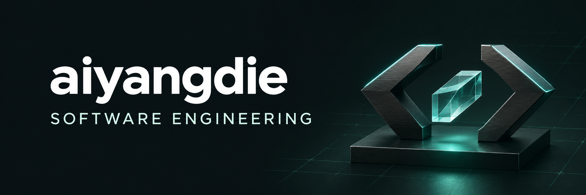
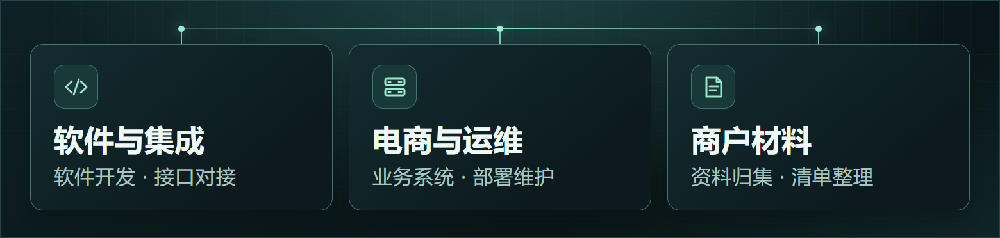

# 软件开发与商家数字化

面向商家和中小团队，开发线上经营工具与内部系统，提供接口集成、部署和持续维护支持。

[业务方向](#业务方向) · [项目实例](#项目实例) · [交付与维护](#交付与维护)

## 业务方向

### 软件开发与系统集成

开发网站、小程序、管理后台、AI 应用和工具软件。按业务流程对接第三方接口，处理权限、回调和数据同步。

### 电商技术支持与 IT 运维

围绕商品、订单和售后流程提供系统开发与维护支持。按项目开展环境部署、巡检、故障排查和版本更新。

### 商户材料整理协助

协助梳理平台通知和材料要求，归集订单、退款与履约凭证，整理材料清单、缺项和处理记录。

## 项目实例

| 项目 | 状态与实现 |
| --- | --- |
| **Windows 系统监控工具** | **MIT 开源 · 已发布** Python 终端工具，用于查看硬件指标和基础诊断信息。 |
| **选课管理系统** | **MIT 开源 · 教学演示** 使用 Spring Boot、Vue 和 MySQL 展示课程、排课和选课管理流程。 |
| **AI 合同草稿工具** | **开发原型** 使用 React 和 TypeScript 实现模板选择、草稿生成与预览。 |

## 交付与维护

1. **确认范围** · 明确功能、对接条件与验收标准。
2. **开发与验证** · 完成约定的开发、接口联调与测试，记录待确认事项。
3. **部署与交接** · 按项目约定提供部署说明、验收清单与维护记录。
